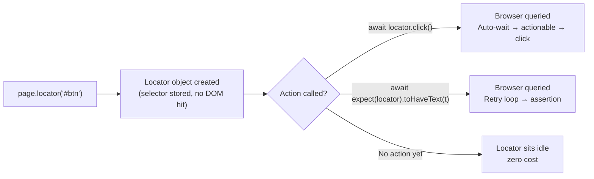
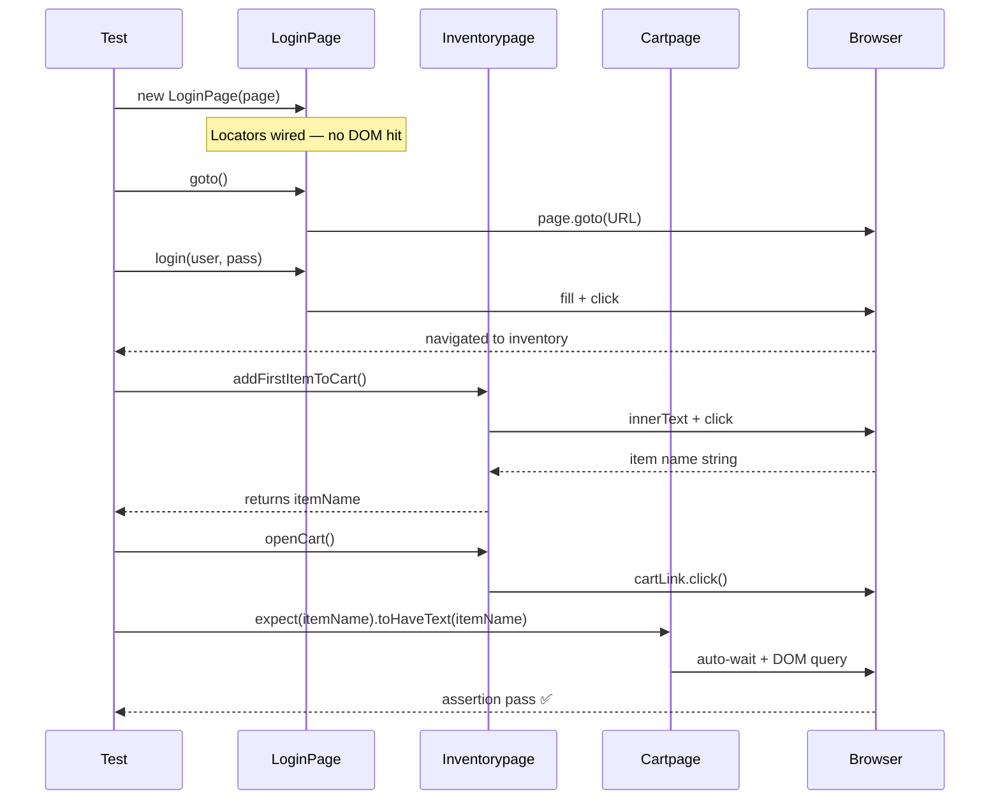

# MASTER — Page Object Model (POM) in Playwright

**Chapter:** 29 — Playwright Fundamentals | Sub-chapter: 20 — Page Object Model
**Files Covered:** `299_No_POM.spec.ts`, `300_POW.spec.ts`, `301_cart_add_assertion.spec.ts`, `302_Heavy_POM.spec.ts`, `pages/LoginPage.ts`, `pages/InventoryPage.ts`, `pages/CartPages.ts`, `pages/HeavyPage.ts`

---

## 1. Syntax Reference — End to End

### Page Object Class Structure

```typescript
import { type Page, type Locator } from '@playwright/test';

export class LoginPage {
    // 1. Page reference
    readonly page: Page;

    // 2. Locator properties (lazy — no DOM query on creation)
    readonly emailInput: Locator;
    readonly passwordInput: Locator;
    readonly loginButton: Locator;

    // 3. Constructor — wire locators, inject page
    constructor(page: Page) {
        this.page = page;
        this.emailInput = page.getByRole('textbox', { name: 'Username' });
        this.passwordInput = page.getByRole('textbox', { name: 'Password' });
        this.loginButton = page.locator('[data-test="login-button"]');
    }

    // 4. Navigation action
    async goto() {
        await this.page.goto('https://app.thetestingacademy.com/playwright/ttacart/');
    }

    // 5. Interaction actions
    async login(username: string, password: string) {
        await this.emailInput.fill(username);
        await this.passwordInput.fill(password);
        await this.loginButton.click();
    }
}
```

### Using Multiple Page Objects in a Spec

```typescript
import { test, expect } from '@playwright/test';
import { LoginPage } from './pages/LoginPage';
import { Inventorypage } from './pages/InventoryPage';
import { Cartpage } from './pages/CartPages';

test('end-to-end cart flow', async ({ page }) => {
    const login = new LoginPage(page);
    const inventory = new Inventorypage(page);
    const cart = new Cartpage(page);

    await login.goto();
    await login.login('user', 'pass');
    const itemName = await inventory.addFirstItemToCart();
    await inventory.openCart();
    await expect(cart.itemName).toHaveText(itemName);
});
```

### Custom `data-test` Attribute Helper Pattern

```typescript
// Inside a page object constructor — centralises the attribute name
const byTest = (id: string) => page.locator(`[data-test="${id}"]`);
this.title    = byTest('title');
this.cartLink = byTest('shopping-cart-link');
```

---

## 2. Built-in Functions & Methods Used

| API | Purpose | Notes |
|-----|---------|-------|
| `page.locator(selector)` | Creates a lazy locator | Sync, no DOM hit |
| `page.getByRole(role, opts)` | Locates by ARIA role + accessible name | Most resilient |
| `page.getByTestId(id)` | Locates by `data-testid` attribute | Config `testIdAttribute` if custom |
| `page.getByText(text)` | Locates by visible text content | Fragile to i18n |
| `locator.or(other)` | Compound locator — first match wins | Playwright v1.33+ |
| `locator.fill(text)` | Clears and types | Triggers DOM events |
| `locator.click()` | Clicks the element | Auto-waits for actionability |
| `locator.innerText()` | Returns visible text | Returns `string`, use with `await` |
| `expect(locator).toHaveText(t)` | Web-first text assertion | Retries until timeout |
| `expect(locator).toBeVisible()` | Asserts element is visible | Retries |
| `test.step(name, fn)` | Named step group | Appears in HTML report |
| `Object.getOwnPropertyNames(proto)` | List all class methods | Used in 302 benchmark |

---

## 3. Deep Insights & Gotchas

### Locators Are Lazy — The Core Insight

`page.locator('[data-test="title"]')` does **not** query the browser. It records a selector description. The browser is contacted only when you call `click()`, `fill()`, `innerText()`, or `expect()`.

**Consequence:** A constructor with 100 locators takes ~0ms. A POM can describe an entire multi-tab application and cost nothing until a test action triggers it.

### Methods Live on the Prototype

```typescript
const a = new HeavyPage(page);
const b = new HeavyPage(page);
// a.goto === b.goto  →  true  (same function reference, one copy)
// a.title !== b.title  →  different Locator instances per object
```

Each instance creates new `Locator` objects (instance properties). Methods live once on `HeavyPage.prototype` — shared by all instances. Memory for methods is O(1); locator instances are O(n) but each is a tiny value object.

### `readonly` Is a TypeScript Guard, Not Runtime

`readonly page: Page` prevents TypeScript compile-time re-assignment of `this.page`. At JavaScript runtime it is a normal mutable property. Use `readonly` to signal design intent: the page reference should never change post-construction.

### The `.or()` Chain Order Matters

```typescript
page.getByRole('button', { name: 'Login' })
    .or(page.getByTestId('login-btn'))  // checked if role fails
    .or(page.getByText('Login'))        // last resort
```

Playwright resolves the first selector that matches the DOM at the moment of action. Put the most stable selector first (`getByRole`), least stable last (`getByText`).

### Sharing State Across `test.step` With `let`

```typescript
let itemName = '';              // declared at test scope

await test.step('add item', async () => {
    itemName = await inventory.addFirstItemToCart();  // set here
});

await test.step('verify cart', async () => {
    await expect(cart.itemName).toHaveText(itemName); // read here
});
```

Step closures capture the outer `let` by reference. This is idiomatic and safe within a single test. Never use module-level variables — they bleed across parallel workers.

---

## 4. Interview-Ready Definitions

**Page Object Model (POM):** A design pattern that creates a typed TypeScript class for each page or component. The class owns all locators and interaction methods. Specs import these classes instead of writing raw locator calls inline.

**Locator:** A Playwright object that lazily describes how to find an element. It is not a DOM node and does not query the browser when created — only when an action or assertion is called on it.

**Lazy Locator:** A locator created with `page.locator()` or `page.getByRole()` that stores a selector strategy and re-evaluates it against the live DOM at the moment of use. Never stale.

**Compound Locator (`.or()`):** Two or more locators chained with `.or()`. Playwright tries each in order and uses the first that resolves. Useful for elements with different attributes across environments.

**Constructor Injection:** Passing the Playwright `page` instance into a page object class via its constructor. The class stores it as `readonly page` and uses it to build locators.

**Prototype Methods:** Methods declared in a class body placed on `ClassName.prototype` — shared by all instances. Only `this.property = ...` in the constructor creates per-instance data.

**`test.step()`:** Wraps test code with a named label. Steps appear as collapsible rows in the HTML report, each with their own duration and attached screenshots.

---

## 5. Tricky Interview Questions (12 Questions)

**Q1: Does `page.locator('#email')` query the browser?**
No. It creates a lazy `Locator` object storing the CSS selector. The browser is queried only when `click()`, `fill()`, `innerText()`, or `expect()` is called.

**Q2: If you create 100 locators in a POM constructor, how long does it take?**
Microseconds to low single-digit milliseconds. Each call is a string assignment plus a tiny JS object allocation — no network, no DOM, no browser process involvement.

**Q3: What is the difference between `page.locator()` and `await page.$()` in a constructor?**
`page.locator()` is sync and lazy — safe in constructors. `await page.$()` is async and queries the DOM immediately — it cannot be used in a sync constructor and returns a stale-able `ElementHandle`.

**Q4: Why declare locators as `readonly` in a POM class?**
TypeScript `readonly` is a compile-time guard preventing accidental re-assignment after construction. It signals that the locator reference is fixed for the object's lifetime.

**Q5: How do you share data between two `test.step()` closures?**
Declare a `let` variable at the test function scope. Set it inside one step, read it in another. Step closures capture the outer variable by reference.

**Q6: Why is `getByRole` preferred over `locator('#id')` in a POM?**
ARIA roles are far more stable than HTML attributes. A developer can refactor an `id` without affecting ARIA semantics, making `getByRole` resilient to implementation changes.

**Q7: What does `.or()` do and when should you use it?**
Creates a compound locator that tries each selector in order. Use it when the same element has different attributes across environments or during an app migration period.

**Q8: Are prototype methods duplicated when you create two instances of the same class?**
No. Class methods exist once on `ClassName.prototype`. Both instances reference the same function objects via the prototype chain. Only constructor `this.xxx = ...` assignments create per-instance data.

**Q9: What happens if you put `await page.$('#foo')` inside a POM constructor?**
The constructor implicitly returns a Promise, breaking the `new ClassName(page)` pattern. You cannot `await new ClassName(page)` — it is non-standard. Use `page.locator('#foo')` (sync, lazy) instead.

**Q10: How does `addFirstItemToCart()` returning the item name improve design?**
The page object captures the name at the moment of action and hands it back to the test cleanly. The test never needs a raw `locator.innerText()` call — selector knowledge stays inside the class.

**Q11: When would you replace manual POM instantiation with Playwright fixtures?**
When the same page object is used in many tests. Fixtures provide automatic setup/teardown, support `beforeAll` caching (e.g., login once, reuse `storageState`), and remove `new LoginPage(page)` boilerplate from every test.

**Q12: What would make the `buildMs < 100` assertion in `302_Heavy_POM.spec.ts` fail?**
If any constructor assignment performed async DOM work — e.g., replacing `page.locator(...)` with `await page.waitForSelector(...)`. Eager DOM queries make constructors slow and async, which the benchmark is designed to detect and prevent.

---

## 6. Controversial Topics & Ongoing Debates

### "POM is over-engineering for small suites"

**For:** A 10-test suite with inline locators is faster to write and read without extra files.
**Against:** Suites rarely stay small. Inline locator duplication costs compound exponentially. POM investment is front-loaded; maintenance savings compound.
**Verdict:** Use POM from test #1 in any application expected to grow.

### "Should page objects include assertions?"

**Traditional POM:** Only navigation and interaction — assertions live in specs.
**Hybrid approach:** Some teams add `assertLoginSucceeded()` to page objects to avoid duplicating `expect` calls.
**Verdict:** Keep assertions in specs. A page object with side-effect assertions becomes hard to reuse in contexts where the assertion is unwanted.

### "Fixtures vs Page Objects — which is better?"

They solve different problems. Page objects encapsulate a screen's interface. Fixtures manage lifecycle (setup, teardown, caching). Idiomatic Playwright uses both: fixtures provide pre-built, pre-authenticated page object instances.

### "Is `.or()` a code smell?"

`.or()` is appropriate during migrations or multi-environment targeting. In stable apps, it signals attribute strategy has not been finalised. Overusing it masks instability that should be fixed at the source.

---

## 7. Quick Reference Cheat Sheet

```
POM Pattern
━━━━━━━━━━━━━━━━━━━━━━━━━━━━━━━━━━━━━━━
Class structure:
  ├── readonly page: Page
  ├── readonly <locator>: Locator   (one per UI element)
  ├── constructor(page: Page)        (wires locators — sync)
  ├── async goto()                   (navigation)
  └── async <action>(args): ReturnType  (interactions)

Locator Priority (most → least stable):
  1. getByRole       → ARIA semantic
  2. getByTestId     → data-testid / data-test
  3. getByLabel      → tied to form label text
  4. getByPlaceholder→ placeholder text
  5. locator(css)    → specific CSS
  6. getByText       → visible text (avoid for stable suites)

data-test helper:
  const byTest = (id) => page.locator(`[data-test="${id}"]`);

Compound selector:
  locA.or(locB).or(locC)  → first match in DOM wins

Share data across steps:
  let val = '';
  await test.step('set', async () => { val = await page.xxx(); });
  await test.step('use', async () => { await expect(...).toHaveText(val); });

Key facts:
  • Lazy locator = no DOM query at construction time
  • Prototype method = shared once, O(1) per new class instance
  • readonly = TypeScript compile-time guard, not runtime
```

---

## 8. Memory Map & Visual Flowchart

### POM Architecture

```
                       ┌─────────────────────┐
                       │    spec file         │
                       │ (what the user does) │
                       │                      │
                       │  const lp = new      │
                       │   LoginPage(page)    │
                       │  await lp.login(..)  │
                       └────────┬────────────┘
                                │ delegates to
              ┌─────────────────┼────────────────┐
              │                 │                 │
     ┌────────▼──────┐  ┌──────▼──────┐  ┌──────▼──────┐
     │  LoginPage    │  │ Inventorypage│  │  Cartpage   │
     │               │  │              │  │             │
     │ emailInput    │  │ title        │  │ title       │
     │ passwordInput │  │ firstItemName│  │ itemName    │
     │ loginButton   │  │ cartLink     │  │ itemPrice   │
     │               │  │              │  │ checkout    │
     │ goto()        │  │ goto()       │  │ goto()      │
     │ login()       │  │ addFirst()   │  │             │
     └───────────────┘  └─────────────┘  └─────────────┘
              │                 │                 │
              └─────────────────▼─────────────────┘
                         Playwright Page
                      (shared page instance)
                              │
                         Browser Tab / DOM
```

### Locator Laziness Flow



### Multi-Step End-to-End Flow



---

## 9. LinkedIn-Style Post

> **🎭 "But won't 100 locators slow down my test?"**
>
> I had this exact worry when I started writing Playwright Page Objects.
>
> So I ran an experiment. I built a `HeavyPage` class with **100 locators** and **110 methods**. Then I timed the constructor.
>
> Result: **0ms.**
>
> Here's why: Playwright locators are **lazy**. `page.locator('[data-test="buy-now"]')` doesn't query the browser — it records a selector string. The browser is only contacted when you `click()`, `fill()`, or `expect()` on the locator.
>
> And methods? They live on the **prototype** — shared across every instance. Creating a second `HeavyPage` adds 100 new `Locator` value objects but zero method copies.
>
> So the next time someone says *"your page object is too big"* — show them the numbers. Large POMs are architecturally safe. Small POMs that leak selector logic into specs are the real risk.
>
> **The lesson from 299→302:**
> - No POM → 10 lines of selector noise per test, brittle at scale
> - Minimal POM → 3 lines of intent, one class to change
> - Multi-page POM → three classes compose, data flows cleanly between steps
> - Heavy POM → proves the pattern has no runtime cost
>
> POM isn't ceremony. It's compound interest on your maintenance budget.
>
> \#Playwright \#TestAutomation \#TypeScript \#PageObjectModel \#QAEngineering
